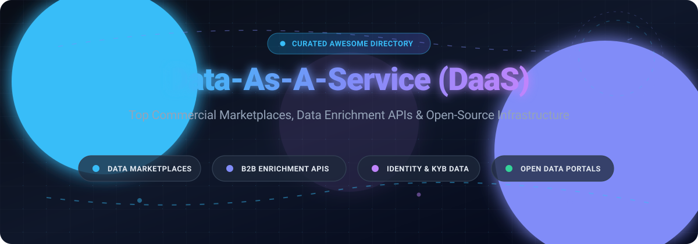

<div align="center">

<a href="https://github.com/ishandutta2007/Awesome-Data-As-A-Service-DAAS">
  
</a>

# 🚀 Awesome Data-As-A-Service (DaaS)

<p align="center">
  <strong>Curated Directory of Top SaaS Platforms &amp; Open-Source Projects for Data-as-a-Service (DaaS), Data Marketplaces, B2B Firmographics, Identity Resolution &amp; External Data Activation.</strong>
</p>

<p align="center">
  <a href="https://github.com/ishandutta2007/Awesome-Awesome-Awesome"></a>
  <a href="https://discord.gg/jc4xtF58Ve"></a>
  <a href="https://github.com/ishandutta2007/Awesome-Data-As-A-Service-DAAS/stargazers"></a>
  <a href="https://github.com/ishandutta2007/Awesome-Data-As-A-Service-DAAS/network/members"></a>
  <a href="https://github.com/ishandutta2007/Awesome-Data-As-A-Service-DAAS/blob/main/LICENSE"></a>
  <a href="https://github.com/ishandutta2007/Awesome-Data-As-A-Service-DAAS/pulls"></a>
  <a href="https://github.com/ishandutta2007"></a>
</p>

<p align="center">
  🌟 <em>Star this repository if you find it helpful!</em> 🌟
</p>

</div>

---

## 📌 Executive Summary

This repository is an SEO-optimized, production-ready curated index tracking commercial **Data-as-a-Service (DaaS)** SaaS platforms and cutting-edge **open-source data ecosystem projects**. Whether you are architecting an enterprise data marketplace, integrating real-time B2B firmographic enrichment into CRM pipelines, evaluating KYB merchant risk feeds, or deploying self-hosted open data sharing infrastructure, this guide covers verified pricing, free tier thresholds, valuation metrics, and architecture trade-offs.

- **Primary Topics**: Data-as-a-Service, DaaS, Data Marketplace, Firmographic Data, Identity Resolution, Data Enrichment API, Open Data Portals, External Data Monetization.
- **Coverage**: Enterprise Cloud Marketplaces, B2B Contact Feeds, Public Web Alternative Data, Open-Source Protocols, Self-Hosted Portals.
- **Last Updated**: October 2026.

---

## 📑 Table of Contents

- [📊 Sector Overview &amp; Market Dynamics](#-sector-overview--market-dynamics)
- [🏢 SaaS / Hosted Commercial Platforms](#-saas--hosted-commercial-platforms)
- [💻 Open-Source GitHub Projects](#-open-source-github-projects)
- [⚙️ Open-Source DaaS Architecture Patterns](#️-open-source-daas-architecture-patterns)
- [🤝 How to Contribute](#-how-to-contribute)
- [💖 Support &amp; Community](#-support--community)
- [⭐ Star History](#-star-history)
- [⚖️ Disclaimer &amp; Compliance](#️-disclaimer--compliance)

---

## 📊 Sector Overview &amp; Market Dynamics

The global **Data-as-a-Service (DaaS)** market is estimated at **$23B to $26B in 2025–2026** and projected to surpass **$50B+ by 2030**, expanding at a **15%–20% CAGR** fueled by generative AI demand for high-quality external model training, RAG ground truth, and real-time fine-tuning datasets.

The industry exhibits a **moderately fragmented** market structure:
- **Top-Tier Concentration**: Hyperscale cloud marketplaces (Snowflake, Databricks) and traditional enterprise information giants capture **45%–50% of aggregate industry revenue** through proprietary data networks and deep cloud ecosystem integration.
- **Long-Tail Competitive Fragmentation**: The remaining half of the market is actively contested by a dynamic long-tail of pure-play data vendors and specialized APIs focusing on niche verticals, real-time public web scraping, technographics, SMB financial transactions, and privacy-preserving data exchanges.

---

## 🏢 SaaS / Hosted Commercial Platforms

Commercial DaaS providers deliver turn-key data feeds, pre-packaged firmographics, identity graphs, and live queries without data replication.

> [!NOTE]
> Platforms below are sorted in descending order by **Company Valuation / Scale**. All pricing tiers reflect verified entry-level commercial costs and specific free tier / evaluation limits.

| 🏢 Platform | 💰 Valuation / Company Size | 🏷️ Pricing (Starting Tier) | 🎁 Free Tier / Trial Limits | 🎯 Key Capabilities &amp; Best For |
| :--- | :--- | :--- | :--- | :--- |
| **[Databricks Marketplace](https://www.databricks.com/)** | **~$190B valuation** ($7B+ ARR run-rate) | Consumption-based starting at **$0.07/DBU** (Jobs Light) to **$0.22–$0.55/DBU** (SQL/Jobs); third-party provider listings priced individually | **14-day free trial** with **$400 in trial credits** (underlying cloud infrastructure compute/storage billed separately) | Open lakehouse data exchange powered by Delta Sharing; best for data engineering and AI/ML teams executing direct cross-platform analytics. |
| **[Snowflake Data Marketplace](https://www.snowflake.com/)** | **~$110B market cap** ($4.7B+ TTM revenue) | Consumption-based starting at **$2.00/credit** (Standard Edition warehouse) + storage from ~$23–$40/TB/month; data vendor listings priced individually | **30-day free trial** with **$400 in usage credits** | Zero-copy SQL joins across live third-party databases; best for enterprises already on Snowflake seeking external data activation without ETL pipelines. |
| **[Workday Data As A Service](https://www.workday.com/)** | **~$50B market cap** ($10.1B TTM revenue) | Custom enterprise quote; HCM base suites benchmark around **$96–$504/employee/year** with modular data add-ons | **No free tier** for core platform; **30-day free trial** available specifically for Workday Adaptive Planning test tenant | Governed industry benchmarking, HR analytics, and financial data services embedded directly into the Workday ERP suite. |
| **[Experian Data Quality](https://www.experian.com/)** | **~$35B market cap** ($8.8B annual revenue) | Enterprise quote-based; Aperture Data Studio deployments baseline around **$72,000–$110,000+/year**; API packages scale by credit pack | **14-day free trial** capped at **500 Address, 500 Email, and 500 Phone validation credits** | Enterprise-grade identity verification, postal address cleansing, customer deduplication, and regulatory data hygiene. |
| **[Clearbit](https://clearbit.com/) (HubSpot)** | **~$13B parent market cap** ($1.9B+ parent revenue) | Integrated into HubSpot Breeze Intelligence; requires paid HubSpot Starter starting at **$15–$20/seat/month** | **No standalone free tier** (legacy free API &amp; extensions sunset); free HubSpot CRM accounts do not include enrichment credits | Real-time B2B firmographic, technographic, and contact enrichment native to HubSpot inbound marketing and sales flows. |
| **[ZoomInfo](https://www.zoominfo.com/)** | **~$1.2B market cap** ($1.2B annual revenue) | Annual contracts only, Professional tier starting at **$14,995/year** (~$1,250/month) for a baseline of 3 user seats | **ZoomInfo Lite free tier** (heavily restricted monthly lookups); no self-serve free trial for core SalesOS database | Comprehensive global B2B contact intelligence, intent data signals, and enterprise organizational chart mapping. |
| **[People Data Labs](https://www.peopledatalabs.com/)** | **~$350M valuation** ($47M+ funding, ~$18M ARR) | Pro tier starting at **$98/month** for 350 person credits ($0.28/match) or **$100/month** for 1,000 company credits | **Free forever plan** with **100 credits/month** (contact details obfuscated, testing and schema evaluation only) | Developer-first REST API providing raw resume, workforce, and company data graphs across 3B+ individual profile records. |
| **[Crunchbase Enterprise](https://www.crunchbase.com/)** | **~$200M valuation** ($100M funding, ~$38M ARR) | Pro tier starting at **$49/month** (billed annually at $588/yr) or $99/month-to-month; Business tier starts at **$199/month** | **7-day free trial** of Pro (exports locked); basic free account limited to **~5 search results/query and 0 export rows** | Definitive private market intelligence tracking startup venture rounds, executive changes, unicorn valuations, and investor portfolios. |
| **[Enigma](https://www.enigma.com/)** | **~$150M valuation** ($130M funding, ~$15M ARR) | Pro tier starting at **$20/month** (includes 2,100 credits; overage at 1¢/credit); Max tier at **$200/month** (25,000 credits) | **Free forever plan** at **$0/month** for unlimited console browsing, company search, and live summary views (attributes cost credits) | Merchant transaction volume insights, card revenues, small business health metrics, and automated KYB onboarding checks. |
| **[Coresignal](https://www.coresignal.com/)** | **~$30M revenue** (Bootstrapped / Profitable) | Mini tier starting at **$49/month**; Starter tier at **$199/month** (10% discount on annual commitments) | **7-day free trial** with **2,000 API credits** capped at 5 req/sec (strictly 1 trial per verified business email domain) | Fresh, structured public web data feeds spanning 100M+ companies, executive job shifts, employee reviews, and job postings. |

---

## 💻 Open-Source GitHub Projects

Open-source DaaS platforms enable teams to deploy self-hosted data portals, operate decentralized data monetization protocols, and run secure data sharing hubs without vendor lock-in.

> [!TIP]
> Repositories below are equipped with live Stars_Badges (`style=social`, `color=white`) linking directly to their official stargazers pages, sorted in **descending order of GitHub_Stars** ⭐.

### 1. **[CKAN](https://github.com/ckan/ckan)** [](https://github.com/ckan/ckan/stargazers)
* **The world's leading open-source data management system (DMS) and data portal platform** (GPL-3.0)
* **Overview**: CKAN powers flagship national open-data portals including *Data.gov* (US), *Open.canada.ca* (Canada), and *Data.humdata.org* (UN OCHA). It provides complete dataset publishing, rich geospatial metadata search, API access via DataStore/DataPusher, and granular organization access controls.
* **Tech Stack**: Python (Flask/SQLAlchemy), PostgreSQL, Solr, Redis.
* **Best For**: Governments, public sector bodies, research institutions, and large enterprises requiring a battle-tested portal to publish, catalog, and share thousands of public or internal datasets.

### 2. **[PortalJS](https://github.com/datopian/portaljs)** [](https://github.com/datopian/portaljs/stargazers)
* **AI-native modern framework for building data portals and dataset frontends** (MIT)
* **Overview**: Created by Datopian (the founding maintainers of CKAN), PortalJS allows engineering teams to scaffold high-performance, modern data catalog experiences in minutes. It supports backend-agnostic dataset loading (CKAN, GitHub flat files, Frictionless Data) and integrates agentic workflows for autonomous dataset indexing.
* **Tech Stack**: TypeScript, Next.js, React, TailwindCSS.
* **Best For**: Modern product and web engineering teams looking to build headless, blazing-fast data portals and external data showcase pages with contemporary JavaScript tooling.

### 3. **[ODD Platform (Open Data Discovery)](https://github.com/opendatadiscovery/odd-platform)** [](https://github.com/opendatadiscovery/odd-platform/stargazers)
* **Open-source data discovery, data lineage, and observability platform** (Apache-2.0)
* **Overview**: Provides comprehensive metadata management, cross-system data lineage, SLA tracking, and data health observability. Built to help organizations catalog and govern internal/external data assets while tracking data quality degradation in production pipelines.
* **Tech Stack**: Java, Spring Boot, React, PostgreSQL.
* **Best For**: Data platform teams requiring automated end-to-end lineage, discovery, and governance across disparate cloud data lakes and external data feeds.

### 4. **[Delta Sharing](https://github.com/delta-io/delta-sharing)** [](https://github.com/delta-io/delta-sharing/stargazers)
* **Open protocol for secure, real-time cross-platform data sharing** (Apache-2.0)
* **Overview**: Delta Sharing establishes the first open standard for sharing massive live datasets directly across organizations, compute engines, and clouds without copying data. It natively underpins commercial offerings like Databricks Marketplace and integrates seamlessly with PowerBI, Pandas, Apache Spark, and Presto/Trino.
* **Tech Stack**: Scala, Python, Rust, Delta Lake.
* **Best For**: Data engineering teams wanting to deliver secure, zero-copy DaaS data feeds to external clients regardless of their downstream compute stack.

### 5. **[Magda](https://github.com/magda-io/magda)** [](https://github.com/magda-io/magda/stargazers)
* **Federated microservice data catalog and discovery platform for big and small data** (Apache-2.0)
* **Overview**: Originally engineered for the Australian Commonwealth Government (*data.gov.au*), Magda features a cloud-native Kubernetes architecture designed for automated metadata harvesting from disparate sources (CKAN, CSW, ESRI), enterprise authorization policies (Open Policy Agent), and deep search indexing.
* **Tech Stack**: TypeScript, Scala, Kubernetes/Helm, PostgreSQL, Elasticsearch.
* **Best For**: Distributed enterprises and governments needing a scalable, Kubernetes-native federated data catalog pulling from dozens of external data repositories.

### 6. **[Ocean Protocol (ocean.py)](https://github.com/oceanprotocol/ocean.py)** [](https://github.com/oceanprotocol/ocean.py/stargazers)
* **Decentralized data exchange protocol with Compute-to-Data privacy preservation** (Apache-2.0)
* **Overview**: Ocean Protocol allows teams to tokenize and monetize private datasets as Data NFTs (ERC-721) and Datatokens (ERC-20). Its breakthrough **Compute-to-Data (C2D)** paradigm enables buyers to run algorithms and AI training against private datasets without the raw data ever leaving the host premises—only verified computation outputs are returned.
* **Tech Stack**: Python (ocean.py), Smart Contracts (Solidity), IPFS/Arweave, decentralized cloud storage.
* **Best For**: Organizations handling sensitive, regulated healthcare, financial, or mobility data who want to monetize data algorithms while guaranteeing zero data leakage.

### 7. **[UDAM (Unified Data Agent Marketplace)](https://github.com/data-agent-marketplace/data-agent-marketplace)** [](https://github.com/data-agent-marketplace/data-agent-marketplace/stargazers)
* **API-first open data marketplace backend for AI agents and developer data monetization** (MIT)
* **Overview**: Provides an out-of-the-box infrastructure template for listing data services and APIs, issuing AES-256 encrypted access tokens, processing Stripe checkout flows, and handling concurrency-safe transactions with PostgreSQL row locks.
* **Tech Stack**: Node.js, Express, Next.js, PostgreSQL 16, Stripe API.
* **Best For**: Indie developers and boutique data agencies building their own commercial API checkout marketplace with token licensing built in.

### 8. **[Company Atlas](https://github.com/CoreSheep/company-atlas)** [](https://github.com/CoreSheep/company-atlas/stargazers)
* **Unified open-source firmographic data aggregation platform** (MIT)
* **Overview**: A practical open-source data pipeline aggregating Fortune 1000 company datasets from Kaggle, Wikipedia, and SEC filings. Demonstrates automated enrichment pipelines utilizing modern scraping and asynchronous HTTP frameworks.
* **Tech Stack**: Python, AsyncIO, HTTPX, BeautifulSoup, Trio.
* **Best For**: Researchers and data engineers studying firmographic aggregation pipelines or needing baseline offline corporate datasets.

### 9. **[daas-sdk](https://docs.rs/crate/daas/)** [](https://crates.io/crates/daas)
* **Rust SDK for building Privacy-by-Design Data-as-a-Service microservices** (Apache-2.0)
* **Overview**: A specialized developer framework implementing core DaaS architecture patterns in Rust. Includes embedded local storage engines, Kafka broker worker threads, and extensible processor traits for building low-latency, tamper-evident data service pipelines.
* **Tech Stack**: Rust, Cargo, Apache Kafka.
* **Best For**: Systems engineers building custom, ultra-high-throughput DaaS microservice topologies where memory safety and privacy-by-design are fundamental.

---

## ⚙️ Open-Source DaaS Architecture Patterns

When building an enterprise-grade Data-as-a-Service system without vendor lock-in, open-source building blocks can be composed into resilient architectures:

```
[ External Data Producers / Crawlers ]
                 │
                 ▼
[ Ingestion & Cleanse: Delta Sharing / Kafka ]
                 │
                 ▼
[ Catalog & Metadata: CKAN / Magda / ODD Platform ]
                 │
    ┌────────────┴────────────┐
    ▼                         ▼
[ Open Access Layer ]   [ Commercial Monetization Layer ]
• PortalJS Web UI       • UDAM (Stripe / API Token Billing)
• Delta Sharing Protocol• Ocean Protocol (Compute-to-Data C2D)
```

1. **The Open Sharing Pattern**: Combine **Delta Sharing** for live query streaming across external clouds with **PortalJS** or **CKAN** for web-based dataset discovery.
2. **The Privacy-Preserving Monetization Pattern**: Deploy **Ocean Protocol** to run AI workloads across sensitive datasets without moving or exposing raw data files.
3. **The API Checkout Pattern**: Deploy **UDAM** in front of your internal data scrapers or enriched SQL databases to bill third-party developers via Stripe tokens.

---

## 🤝 How to Contribute

We actively welcome contributions to keep this directory comprehensive and up to date! 🌟

1. **Fork** this repository.
2. **Add or edit** entries in [`README.md`](README.md).
   - Ensure commercial tools include exact starting prices and free tier limits.
   - Ensure open-source projects include official repository links, Stars_Badges (`style=social`, `color=white`), license info, and practical use cases.
3. **Submit a Pull Request** with a concise description of your additions.

---

## 💖 Support & Community

If you find this repository valuable for your research, team, or project:

- 🌟 **Star this repository** to help others discover it!
- 🍴 **Fork it** and contribute your favorite datasets, APIs, and tools.
- 📢 **Share it** on LinkedIn, X/Twitter, or Reddit.
- ☕ **Support the maintainer**: Buy a coffee or sponsor ongoing maintenance via the **[GitHub Sponsors Dashboard](https://github.com/sponsors/ishandutta2007)**!

[](https://github.com/sponsors/ishandutta2007)

---

## ⭐ Star History

[](https://star-history.dera.page/#ishandutta2007/Awesome-Data-As-A-Service-DAAS&type=date&legend=top-left)

---

## ⚖️ Disclaimer & Compliance

- This repository is an independently curated community resource. Product names, logos, and brands are property of their respective owners.
- **Regulatory Compliance**: Operating or subscribing to Data-as-a-Service platforms handling personal, firmographic, or financial data requires compliance with data privacy standards including **GDPR**, **CCPA/CPRA**, and industry regulations (**FCRA**, **HIPAA**, **SOC 2**).
- Commercial pricing and trial allotments are subject to vendor updates. Always confirm exact licensing quotes directly with the respective service providers before deployment.

---

<div align="center">
  <sub>Built with ❤️ by <a href="https://github.com/ishandutta2007">Ishan Dutta</a> and the open-source data community.</sub>
</div>
